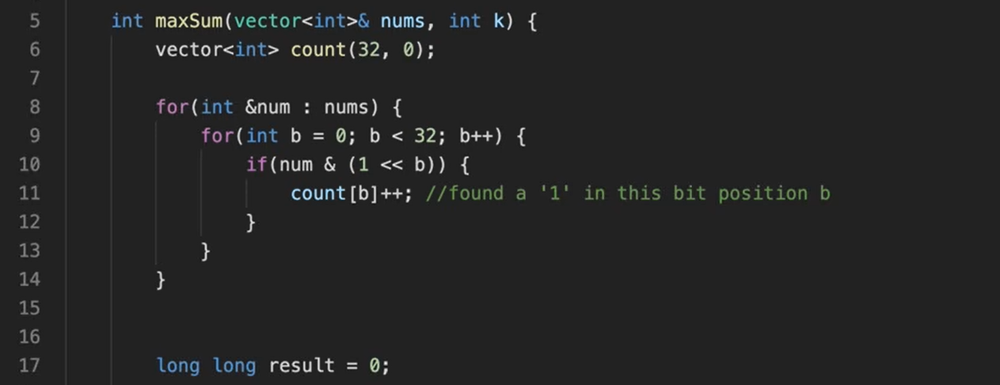
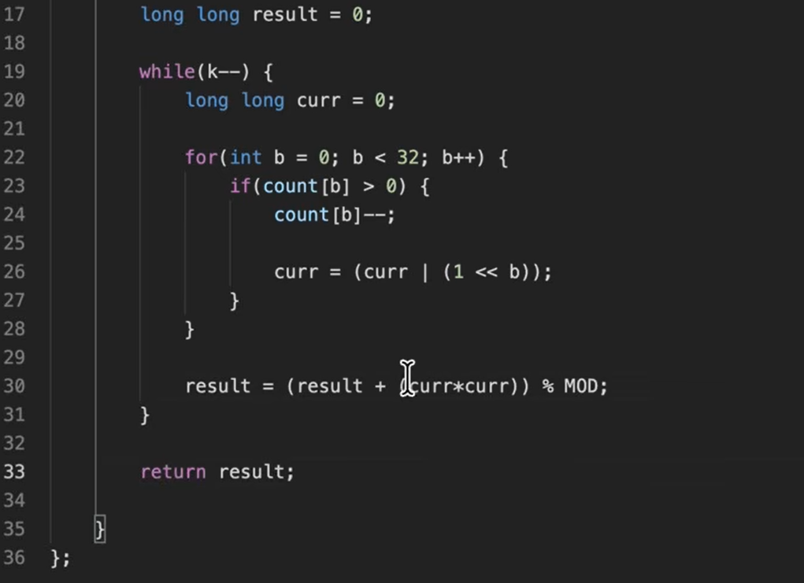

in this we founf that we are just maing one no zero and
adding it to the other no
so  we can see when converted into binary we are just shifting ones to 
other number at same postion 
when we decrease a number but increase the bigger no it incesed 
when we add sq of the no

